# GuardPVM vs. Stock CPython: Architectural Comparison

This document provides a line-by-line comparison between upstream **CPython 3.16** and my **GuardPVM v1.0** implementation, detailing the exact file names (marked with 😀) and line numbers (marked with 🍰).

---

## 📁 Quick Index of File Names & Changed Lines

| # | 😀 File Name (GuardPVM) | 😀 Upstream CPython File | 🍰 Original Lines (Stock CPython) | 🍰 Modified Lines (GuardPVM) | What Changed |
|---|---|---|---|---|---|
| **1** | 😀 [`src/core/Python/ceval_macros.h`](file:///c:/Users/subha/python/GuardPVM/src/core/Python/ceval_macros.h#L208-L232) | `Python/ceval_macros.h` | 🍰 Lines 172 – 176 | 🍰 Lines 208 – 232 | Replaced empty dispatch macro with step quota hook |
| **2** | 😀 [`src/core/Python/bytecodes.c`](file:///c:/Users/subha/python/GuardPVM/src/core/Python/bytecodes.c#L5949-L5962) | `Python/bytecodes.c` | 🍰 Lines 5899 – 5901 | 🍰 Lines 5949 – 5962 | Intercepted division by zero to return 0 in recover mode |
| **3** | 😀 [`src/core/Python/sysmodule.c`](file:///c:/Users/subha/python/GuardPVM/src/core/Python/sysmodule.c#L56-L58) | `Python/sysmodule.c` | 🍰 Line 39 | 🍰 Lines 56 – 58 | Added `pycore_guardpvm.h` header include |
| **4** | 😀 [`src/core/Python/sysmodule.c`](file:///c:/Users/subha/python/GuardPVM/src/core/Python/sysmodule.c#L2928-L3007) | `Python/sysmodule.c` | 🍰 Lines 2893 – 2894 | 🍰 Lines 2928 – 3007 | Added 6 C API methods to `sys` module table |
| **5** | 😀 [`src/core/Python/pylifecycle.c`](file:///c:/Users/subha/python/GuardPVM/src/core/Python/pylifecycle.c#L578-L585) | `Python/pylifecycle.c` | 🍰 Lines 563 – 565 | 🍰 Lines 578 – 585 | Added `_Py_GuardPVM_Init()` boot initialization hook |
| **6** | 😀 [`src/core/Python/getversion.c`](file:///c:/Users/subha/python/GuardPVM/src/core/Python/getversion.c#L30-L40) | `Python/getversion.c` | 🍰 Lines 17 – 19 | 🍰 Lines 30 – 40 | Injected `[GuardPVM v1.0]` flavor identity tag into `sys.version` |
| **7** | 😀 [`src/core/Include/internal/pycore_guardpvm.h`](file:///c:/Users/subha/python/GuardPVM/src/core/Include/internal/pycore_guardpvm.h) | *None (100% New)* | 🍰 File did not exist | 🍰 Lines 1 – 47 | Created central shared telemetry struct `_PyGuardPVMState` |
| **8** | 😀 [`src/core/Python/guardpvm.c`](file:///c:/Users/subha/python/GuardPVM/src/core/Python/guardpvm.c) | *None (100% New)* | 🍰 File did not exist | 🍰 Lines 1 – 178 | Implemented engine logic, env var parser, and telemetry dictionary |

---

## Architecture Flow Comparison

```mermaid
flowchart TD
    subgraph StockCPython["Stock CPython 3.16"]
        A1[Bytecode Instruction] --> B1["DISPATCH()"]
        B1 --> C1["PRE_DISPATCH_GOTO()<br><i>(Evaluates to (void)0 in Release Mode)</i>"]
        C1 --> D1["DISPATCH_GOTO() (Execute Opcode)"]
        D1 --> E1{"Error Occurs?<br>(e.g. 10 / 0)"}
        E1 -- Yes --> F1["ERROR_NO_POP()<br><b>Fatal Crash (Process Halts)</b>"]
        E1 -- No --> G1[Next Instruction]
    end

    subgraph GuardPVM["GuardPVM v1.0"]
        A2[Bytecode Instruction] --> B2["DISPATCH()"]
        B2 --> C2["GUARD_PVM_STEP() Hook"]
        C2 --> H2["1. Increment steps_executed<br>2. Tally opcode frequency"]
        H2 --> I2{"Step Quota Exceeded?<br>(steps >= step_quota)"}
        I2 -- Yes --> J2["Raise RuntimeError<br>Safe 'goto error;' Stack Unwind"]
        I2 -- No --> D2["DISPATCH_GOTO() (Execute Opcode)"]
        D2 --> E2{"ZeroDivisionError?<br>(10 / 0)"}
        E2 -- Yes & Strict Mode --> K2["Fatal Crash (Standard Python)"]
        E2 -- Yes & Recover Mode --> L2["PyErr_Clear()<br>Return Safe 0 & Increment Telemetry"]
        E2 -- No --> G2[Next Instruction]
    end
```



---

## Detailed Line-by-Line Code Comparisons

---

### 1. Instruction Dispatch Loop & Quota Hook
* **😀 File Name:** [`src/core/Python/ceval_macros.h`](file:///c:/Users/subha/python/GuardPVM/src/core/Python/ceval_macros.h#L208-L232)
* **🍰 Original Lines in Stock CPython:** 🍰 Lines 172 – 176 (`cpython/Python/ceval_macros.h`)
* **🍰 Modified Lines in GuardPVM:** 🍰 Lines 208 – 232 (`GuardPVM/src/core/Python/ceval_macros.h`)

#### 🔴 🍰 This is the original line (🍰 Lines 172 – 176 in upstream `Python/ceval_macros.h`):
```c
#ifdef Py_DEBUG
#define PRE_DISPATCH_GOTO() do { \
    if (frame->lltrace >= 5) { \
        lltrace_instruction(frame, stack_pointer, next_instr, opcode, oparg); \
    } \
} while (0)
#else
#define PRE_DISPATCH_GOTO() ((void)0)  /* Empty in release builds */
#endif
```

#### 🟢 🍰 This is the modified line (🍰 Lines 208 – 232 in GuardPVM `src/core/Python/ceval_macros.h`):
```c
/* 😀 changes done here */
#define GUARD_PVM_STEP() do { \
    _Py_GuardPVM_State.steps_executed++; \
    if ((unsigned int)(opcode) < 512) { \
        _Py_GuardPVM_State.opcode_counts[(unsigned int)(opcode)]++; \
    } \
    if (_Py_GuardPVM_State.step_quota > 0 && \
        _Py_GuardPVM_State.steps_executed >= (uint64_t)_Py_GuardPVM_State.step_quota) { \
        _Py_GuardPVM_State.step_quota = 0; \
        frame->instr_ptr = next_instr; \
        next_instr = next_instr + 1; \
        PyErr_SetString(PyExc_RuntimeError, "GuardPVM step quota exceeded"); \
        goto error; \
    } \
} while (0)

#ifdef Py_DEBUG
#define PRE_DISPATCH_GOTO() do { \
    if (frame->lltrace >= 5) { \
        lltrace_instruction(frame, stack_pointer, next_instr, opcode, oparg); \
    } \
    GUARD_PVM_STEP(); \
} while (0)
#else
#define PRE_DISPATCH_GOTO() GUARD_PVM_STEP()
#endif
```

**What changed between these lines:**  
In stock CPython, `PRE_DISPATCH_GOTO()` was a completely empty no-op in release builds. I replaced it with `GUARD_PVM_STEP()`, so every single instruction execution increments the instruction counter and checks against the quota budget before dispatching.

---

### 2. Zero-Division Handling in Arithmetic Opcodes
* **😀 File Name:** [`src/core/Python/bytecodes.c`](file:///c:/Users/subha/python/GuardPVM/src/core/Python/bytecodes.c#L5949-L5962)
* **🍰 Original Lines in Stock CPython:** 🍰 Lines 5899 – 5901 (`cpython/Python/bytecodes.c`)
* **🍰 Modified Lines in GuardPVM:** 🍰 Lines 5949 – 5962 (`GuardPVM/src/core/Python/bytecodes.c`)

#### 🔴 🍰 This is the original line (🍰 Lines 5899 – 5901 in upstream `Python/bytecodes.c`):
```c
            PyObject *res_o = _PyEval_BinaryOps[oparg](lhs_o, rhs_o);
            if (res_o == NULL) {
                ERROR_NO_POP();  /* Hard fatal crash - raises ZeroDivisionError */
            }
```

#### 🟢 🍰 This is the modified line (🍰 Lines 5949 – 5962 in GuardPVM `src/core/Python/bytecodes.c`):
```c
            PyObject *res_o = _PyEval_BinaryOps[oparg](lhs_o, rhs_o);

            /* 😀 changes done here */
            if (res_o == NULL) {
                if (PyErr_ExceptionMatches(PyExc_ZeroDivisionError)) {
                    _Py_GuardPVM_State.zero_div_count++;
                    if (_Py_GuardPVM_State.div_mode == 1) {
                        PyErr_Clear();
                        res_o = PyLong_FromLong(0);  /* Substitute safe 0 return */
                    }
                }
                if (res_o == NULL) {
                    ERROR_NO_POP();  /* Strict mode: standard crash */
                }
            }
```

**What changed between these lines:**  
Stock CPython immediately crashed whenever `res_o == NULL`. I added exception interception so that if the error is a `ZeroDivisionError` and `div_mode == 1` ('recover'), the runtime clears the error, increments the fault counter, and returns `0` to keep pipelines from halting.

---

### 3. Header Include in System Module
* **😀 File Name:** [`src/core/Python/sysmodule.c`](file:///c:/Users/subha/python/GuardPVM/src/core/Python/sysmodule.c#L56-L58)
* **🍰 Original Lines in Stock CPython:** 🍰 Line 39 (`cpython/Python/sysmodule.c`)
* **🍰 Modified Lines in GuardPVM:** 🍰 Lines 56 – 58 (`GuardPVM/src/core/Python/sysmodule.c`)

#### 🔴 🍰 This is the original line (🍰 Line 39 in upstream `Python/sysmodule.c`):
```c
#include "pycore_sysmodule.h"
#include "pycore_unicodeobject.h"
```

#### 🟢 🍰 This is the modified line (🍰 Lines 56 – 58 in GuardPVM `src/core/Python/sysmodule.c`):
```c
#include "pycore_sysmodule.h"

/* 😀 changes done here */
#include "pycore_guardpvm.h"      /* GuardPVM: shared runtime state and API declarations */

#include "pycore_unicodeobject.h"
```

**What changed between these lines:**  
I included the internal `pycore_guardpvm.h` header so the `sys` module can access the global `_Py_GuardPVM_State` telemetry struct and setter functions.

---

### 4. API Functions and Methods Registration in `sys`
* **😀 File Name:** [`src/core/Python/sysmodule.c`](file:///c:/Users/subha/python/GuardPVM/src/core/Python/sysmodule.c#L2928-L3007)
* **🍰 Original Lines in Stock CPython:** 🍰 Lines 2893 – 2894 (`cpython/Python/sysmodule.c`)
* **🍰 Modified Lines in GuardPVM:** 🍰 Lines 2928 – 3007 (`GuardPVM/src/core/Python/sysmodule.c`)

#### 🔴 🍰 This is the original line (🍰 Lines 2893 – 2894 in upstream `Python/sysmodule.c`):
```c
/* Stock CPython had no GuardPVM methods in sys_methods[] */
static PyMethodDef sys_methods[] = {
    SYS_ADDAUDITHOOK_METHODDEF
    SYS_AUDIT_METHODDEF
```

#### 🟢 🍰 This is the modified line (🍰 Lines 2928 – 3007 in GuardPVM `src/core/Python/sysmodule.c`):
```c
/* 😀 changes done here */
/* =========================================================================
 * GUARDPVM SYS MODULE INTERFACE
 * ========================================================================= */
static PyObject *
sys_set_step_quota(PyObject *self, PyObject *arg) { ... }

static PyObject *
sys_get_step_quota(PyObject *self, PyObject *Py_UNUSED(ignored)) { ... }

static PyObject *
sys_get_guard_stats(PyObject *self, PyObject *Py_UNUSED(ignored)) { ... }

static PyObject *
sys_reset_guard_stats(PyObject *self, PyObject *Py_UNUSED(ignored)) { ... }

static PyObject *
sys_set_div_mode(PyObject *self, PyObject *arg) { ... }

static PyObject *
sys_get_div_mode(PyObject *self, PyObject *Py_UNUSED(ignored)) { ... }

static PyMethodDef sys_methods[] = {
    /* 😀 changes done here */
    {"set_step_quota",    (PyCFunction)sys_set_step_quota,    METH_O,      "set_step_quota(limit) -> None"},
    {"get_step_quota",    (PyCFunction)sys_get_step_quota,    METH_NOARGS, "get_step_quota() -> int"},
    {"get_guard_stats",   (PyCFunction)sys_get_guard_stats,   METH_NOARGS, "get_guard_stats() -> dict"},
    {"reset_guard_stats", (PyCFunction)sys_reset_guard_stats, METH_NOARGS, "reset_guard_stats() -> None"},
    {"set_div_mode",      (PyCFunction)sys_set_div_mode,      METH_O,      "set_div_mode(mode: str) -> None"},
    {"get_div_mode",      (PyCFunction)sys_get_div_mode,      METH_NOARGS, "get_div_mode() -> str"},
    SYS_ADDAUDITHOOK_METHODDEF
```

**What changed between these lines:**  
I implemented 6 new C functions and registered them in Python's `sys` module table, allowing user Python scripts to configure step quotas and read telemetry via `import sys`.

---

### 5. Runtime Boot Initialization Hook
* **😀 File Name:** [`src/core/Python/pylifecycle.c`](file:///c:/Users/subha/python/GuardPVM/src/core/Python/pylifecycle.c#L578-L585)
* **🍰 Original Lines in Stock CPython:** 🍰 Lines 563 – 565 (`cpython/Python/pylifecycle.c`)
* **🍰 Modified Lines in GuardPVM:** 🍰 Lines 578 – 585 (`GuardPVM/src/core/Python/pylifecycle.c`)

#### 🔴 🍰 This is the original line (🍰 Lines 563 – 565 in upstream `Python/pylifecycle.c`):
```c
    _Py_InitVersion();
    _Py_DumpTraceback_Init();
```

#### 🟢 🍰 This is the modified line (🍰 Lines 578 – 585 in GuardPVM `src/core/Python/pylifecycle.c`):
```c
    /* 😭 no changes done (Stock CPython) */
    _Py_InitVersion();

    /* 😀 changes done here */
    /*
     * Boot hook:
     * I added _Py_GuardPVM_Init() here in the early runtime lifecycle
     * so that telemetry counters are reset and environment variables are
     * parsed before importlib or user scripts execute.
     */
    _Py_GuardPVM_Init();

    /* 😭 no changes done (Stock CPython) */
    _Py_DumpTraceback_Init();
```

**What changed between these lines:**  
I added a single function call `_Py_GuardPVM_Init();` into the CPython runtime initialization sequence so that GuardPVM state and environment variables are parsed before any Python code runs.

---

### 6. Version Banner & Runtime Identity
* **😀 File Name:** [`src/core/Python/getversion.c`](file:///c:/Users/subha/python/GuardPVM/src/core/Python/getversion.c#L30-L40)
* **🍰 Original Lines in Stock CPython:** 🍰 Lines 17 – 19 (`cpython/Python/getversion.c`)
* **🍰 Modified Lines in GuardPVM:** 🍰 Lines 30 – 40 (`GuardPVM/src/core/Python/getversion.c`)

#### 🔴 🍰 This is the original line (🍰 Lines 17 – 19 in upstream `Python/getversion.c`):
```c
#ifdef Py_GIL_DISABLED
    const char *buildinfo_format = "%.80s free-threading build (%.80s) [%.80s]";
#else
    const char *buildinfo_format = "%.80s (%.80s) [%.80s]";
#endif
```

#### 🟢 🍰 This is the modified line (🍰 Lines 30 – 40 in GuardPVM `src/core/Python/getversion.c`):
```c
    /* 😀 changes done here */
#ifdef Py_GIL_DISABLED
    const char *buildinfo_format = "%.80s free-threading build (%.80s) [GuardPVM v1.0, %.80s]";
#else
    const char *buildinfo_format = "%.80s (%.80s) [GuardPVM v1.0, %.80s]";
#endif
```

**What changed between these lines:**  
I injected the `[GuardPVM v1.0, ...]` flavor tag inside the compiler brackets so `sys.version` identifies this engine without breaking regex parsers in standard tools.

---

### 7. New Files Created for GuardPVM (100% New)

#### A. Master State Header
* **😀 File Name:** [`src/core/Include/internal/pycore_guardpvm.h`](file:///c:/Users/subha/python/GuardPVM/src/core/Include/internal/pycore_guardpvm.h) (🍰 Lines 1 – 47)
* **Upstream:** *Did not exist in stock CPython*
```c
/* 😀 changes done here (100% New File created for GuardPVM) */
typedef struct {
    uint64_t steps_executed;       /* Hardware instruction odometer */
    int64_t  step_quota;           /* Fuel limit before raising RuntimeError */
    uint64_t call_count;           /* Function call counter */
    uint64_t return_count;         /* Function exit counter */
    uint64_t zero_div_count;       /* Zero-division faults intercepted */
    int      div_mode;             /* 0 = strict, 1 = recover */
    uint64_t opcode_counts[512];   /* Frequency tally for each opcode */
    int      initialized;          /* Boot protection flag */
} _PyGuardPVMState;
```

#### B. Engine Backend Implementation
* **😀 File Name:** [`src/core/Python/guardpvm.c`](file:///c:/Users/subha/python/GuardPVM/src/core/Python/guardpvm.c) (🍰 Lines 1 – 178)
* **Upstream:** *Did not exist in stock CPython*
* **Purpose:** Implements `_Py_GuardPVM_Init()`, environment variable parsing (`GUARD_PVM_STEP_QUOTA`, `GUARD_PVM_DIV_MODE`), telemetry dictionary generation, and quota getters/setters.
