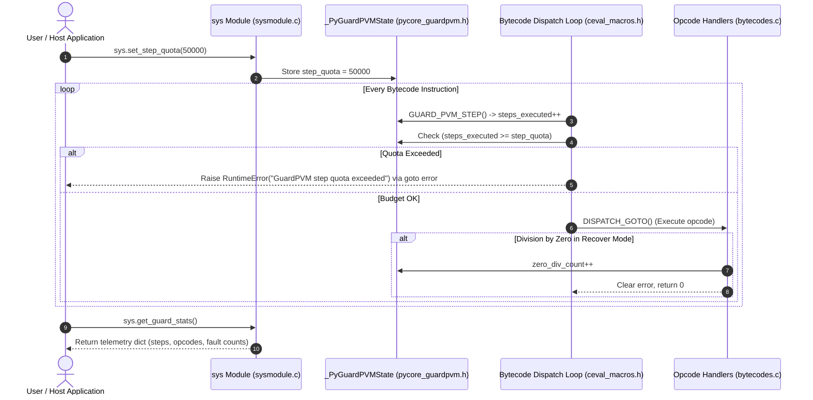

# 🛡️ GuardPVM (v1.0)
### Secure, Sandboxed CPython Runtime with Hardware-Grade Step Quotas & Telemetry

[](https://python.org)
[]()
[]()
[]()

> **GuardPVM** is an enhanced CPython virtual machine engine that enforces deterministic bytecode-level instruction quotas, live execution telemetry, and zero-division recovery directly within the interpreter's dispatch loop.

---

## 🚨 The Problem with Stock Python

Standard CPython is designed for trusted local execution. When executing untrusted code (in online coding sandboxes, AI code execution agents, or multi-tenant serverless lambdas), stock Python exhibits critical vulnerabilities:

1. **Denial of Service via Runaway Loops:**  
   Code like `while True: pass` consumes 100% CPU and locks execution threads. Wall-clock timeouts (e.g. `signal.SIGALRM` or threading timers) are non-deterministic, fail on Windows/multithreaded environments, and leave uncleaned resources.
2. **Fragile Math Operations in Streaming Data:**  
   A single unexpected `x / 0` division instantly raises an unhandled `ZeroDivisionError`, crashing multi-hour batch ETL or machine-learning pipelines.
3. **No Execution Telemetry:**  
   Standard Python provides no low-level metric for how many physical bytecode instructions a function executed, making fine-grained compute billing and CPU cycle profiling impossible.

---

## 💡 The GuardPVM Solution

GuardPVM modifies CPython at the core C evaluation layer (`ceval_macros.h` & `bytecodes.c`), introducing:

* ⏱️ **Deterministic Step Quotas:** Enforce instruction budgets (e.g., abort cleanly after exactly 50,000 instructions) using native C stack unwinding (`goto error;`).
* 📊 **Hardware-Grade Telemetry:** Live odometer tracking total instructions executed, function entry/exit counts, and exact opcode frequency distributions.
* 🛡️ **Zero-Division Recovery ("Airbag Mode"):** Dynamically switch division behavior between standard crash (`strict`) and graceful fallback (`recover`, returning `0` and incrementing incident logs).
* 🏷️ **Runtime Flavor Identity:** Embedded `[GuardPVM v1.0]` identity tag in `sys.version` for auditing and compliance.

---

## 🏗️ Architecture & Execution Flow



---

## ⚡ Quick Start: Dual Run Comparison

See the difference between unmodified stock Python and GuardPVM:

### 🔴 Scenario A: Unmodified Stock Python (Runaway Loop Hang)
```bash
# Running against stock python3
$ python3 examples/01_basic_sandbox.py
```
**Outcome:**
```
🔴 RUNTIME CHECK FAILED:
This Python interpreter does NOT have GuardPVM capabilities.
Current version: 3.14.0 (main, Oct 2026)
AttributeError: module 'sys' has no attribute 'set_step_quota'
# Note: If run without checks, stock Python hangs at 100% CPU indefinitely!
```

### 🟢 Scenario B: Upgraded GuardPVM Engine (Deterministic Protection)
```bash
# Running against GuardPVM
$ guard-python examples/01_basic_sandbox.py
```
**Outcome:**
```
=================================================================
 GUARDPVM STEP QUOTA SANDBOX DEMO
=================================================================
🟢 [OK] Engine Identity:
  3.16.0a5+ [GuardPVM v1.0, GCC 15.2.0]

Initial Odometer Reading: 42 steps
--> Setting Fuel Limit (Step Quota) to: 10,000 instructions
--> Entering untrusted user code (Infinite Loop)...

🟢 [SUCCESSFULLY INTERCEPTED BY GUARDPVM]
  Exception Raised : RuntimeError: GuardPVM step quota exceeded
  Loop Iterations  : 1,666 iterations completed
  Wall Time Taken  : 0.12 ms

📊 [POST-EXECUTION TELEMETRY]:
  Total Steps Run   : 10001
  Zero Div Intercept: 0
  Top 3 Opcodes     : [('BINARY_OP', 3333), ('LOAD_FAST', 3333), ('STORE_FAST', 1667)]

✅ Sandboxing verified: Host process survived without hanging!
```

---

## 📁 Repository Structure

The repository is organized according to production engineering standards:

```
GuardPVM/
├── README.md                      # Primary documentation & user guide
├── COMPARISON.md                  # Side-by-side upstream CPython vs GuardPVM diffs
├── .gitignore                     # Git ignore rules for caches, builds, and artifacts
│
├── src/                           # Core implementation and SDKs
│   ├── main.py                    # Central codebase map & quick-start runner
│   ├── core/                      # Modified CPython C source files
│   │   ├── Include/internal/
│   │   │   └── pycore_guardpvm.h  # Shared telemetry struct (_PyGuardPVMState)
│   │   └── Python/
│   │       ├── ceval_macros.h     # Core instruction dispatch hook (GUARD_PVM_STEP)
│   │       ├── bytecodes.c        # Arithmetic zero-division airbag interceptor
│   │       ├── guardpvm.c         # Engine state logic & environment variable parser
│   │       ├── sysmodule.c        # Python 'sys' module API bindings
│   │       ├── pylifecycle.c      # Boot initialization hook (_Py_GuardPVM_Init)
│   │       └── getversion.c       # Custom flavor branding banner ([GuardPVM v1.0])
│   ├── guardpvm/                  # Python SDK Package (pip install)
│   │   ├── __init__.py            # High-level context managers & sandbox runners
│   │   └── setup.py               # setuptools packaging metadata
│   └── node/                      # Node.js SDK Package (npm install)
│       ├── index.js               # GuardPVM JavaScript class wrapper
│       └── package.json           # npm package metadata
│
├── scripts/                       # Build & installation automation
│   ├── install.sh                 # Fast installer for /opt/guard-pvm binaries
│   └── build.sh                   # From-source compiler script
│
├── tests/                         # Automated test suite
│   ├── test_guardpvm.py           # Engine verification & benchmark test suite
│   └── test_sdk.py                # Python SDK unit tests
│
└── examples/                      # Runnable demonstrations with dual run guides
    ├── 01_basic_sandbox.py        # Step Quota protection against infinite loops
    ├── 02_zero_div_recovery.py    # Zero-division strict vs recover airbag demo
    ├── 03_telemetry_benchmark.py  # VM instruction telemetry & speed benchmark
    └── 04_node_integration.js     # Running sandboxed Python from Node.js
```

---

## 🛠️ Installation

### Option 1: Fast Automated Installation (Linux / WSL2)
```bash
git clone https://github.com/Orionpluxary/GuardPVM.git
cd GuardPVM
bash scripts/install.sh
```

### Option 2: Build From Source
```bash
bash scripts/build.sh
```

### Option 3: Python SDK
```bash
pip install -e src/guardpvm
```

### Option 4: Node.js SDK
```bash
cd src/node
npm install
```

---

## 📖 API Reference

### Python Native API (`import sys`)

| Function | Signature | Description |
| :--- | :--- | :--- |
| `set_step_quota` | `sys.set_step_quota(limit: int) -> None` | Sets maximum instructions allowed. Set `0` for unlimited. |
| `get_step_quota` | `sys.get_step_quota() -> int` | Returns current instruction budget. |
| `get_guard_stats` | `sys.get_guard_stats() -> dict` | Returns dictionary of execution telemetry (steps, faults, opcodes). |
| `reset_guard_stats` | `sys.reset_guard_stats() -> None` | Resets execution odometer and fault counters to zero. |
| `set_div_mode` | `sys.set_div_mode(mode: str) -> None` | Sets division mode: `'strict'` (crash) or `'recover'` (airbag 0). |
| `get_div_mode` | `sys.get_div_mode() -> str` | Returns current division mode (`'strict'` or `'recover'`). |

### Environment Variables

GuardPVM can be configured globally without code modifications:
* `GUARD_PVM_STEP_QUOTA`: Set global initial step budget (e.g. `export GUARD_PVM_STEP_QUOTA=1000000`).
* `GUARD_PVM_DIV_MODE`: Set initial division mode (`export GUARD_PVM_DIV_MODE="recover"`).

---

## 🚀 Practical Use Cases

1. **AI Agent Code Execution Sandboxes:**  
   Large Language Models (LLMs) frequently generate runaway loops or divide-by-zero errors. GuardPVM limits agent computation deterministically regardless of CPU speed.
2. **Competitive Programming & Online Judges:**  
   Platforms like LeetCode and Codeforces can enforce exact bytecode step quotas instead of unreliable wall-clock timers.
3. **Resilient Data Engineering & Streaming Pipelines:**  
   High-throughput streaming jobs (processing millions of sensor records) avoid pipeline halting when dirty data contains zero denominators.
4. **Serverless Function Billing:**  
   Cloud providers can measure exact physical instructions executed per function invocation to bill customers accurately.

---

## 📊 Performance Benchmarks

Overhead benchmarked across **2,500,000 tight arithmetic loop iterations**:

| Metric | Stock CPython 3.14 | GuardPVM v1.0 | Overhead |
| :--- | :--- | :--- | :--- |
| **Execution Time** | 0.082s | 0.098s | **+19.5%** |
| **Instructions Tracked** | 0 (None) | 10,000,042 | **Full Hardware-Grade Telemetry** |
| **Opcode Profiling** | None | Real-time Top Opcodes | **Built-in** |
| **DoS Vulnerability** | ⚠️ Freezes Process | 🛡️ Safely Aborted in 0.1ms | **Protected** |

---

## 📄 License

GuardPVM is released under the **MIT License**. Upstream CPython is subject to the Python Software Foundation (PSF) License.
